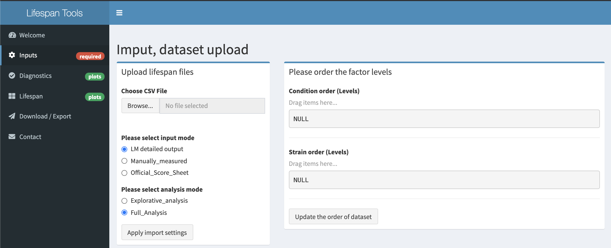
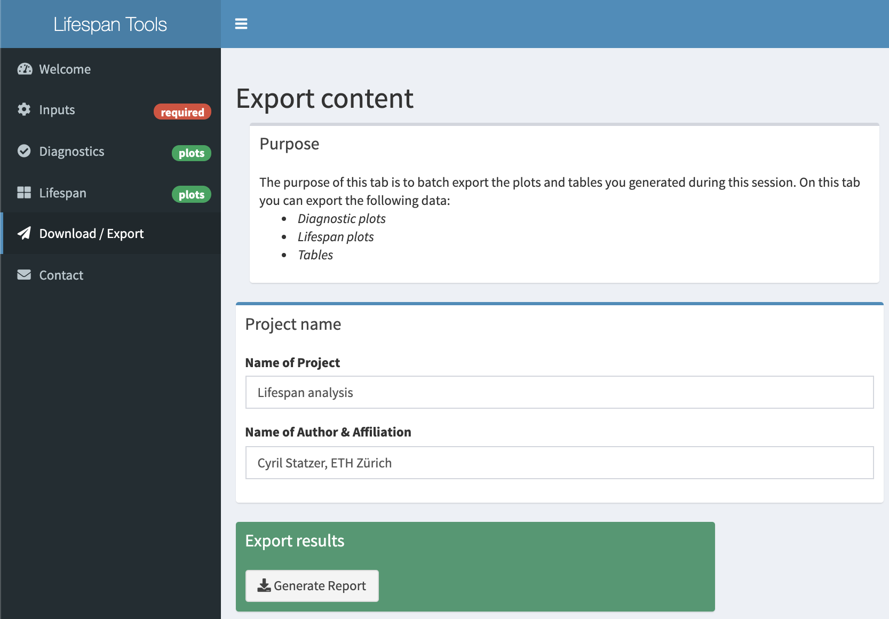

# Lifespan analysis tool

Interactive analysis tool to analyze, visualize and perform statistical tests on lifespan datasets. The tool is compatible with manually measured as well as automatically acquired datasets. Diagnostic features allow the identification of batch effects.

## Available resources
- Interactive Shiny application (`app.R`) for data analysis and visualization.

## Setup
1. Clone the repository.
2. Install dependencies:
   - Open R and run `source("helper.R")` to install and load required packages.
3. Launch the Shiny application:
   - In R, execute `shiny::runApp("app.R")`, or open `app.R` in RStudio and click "Run App".

## App preview

### Importing lifespan datasets

### Export lifespan report

